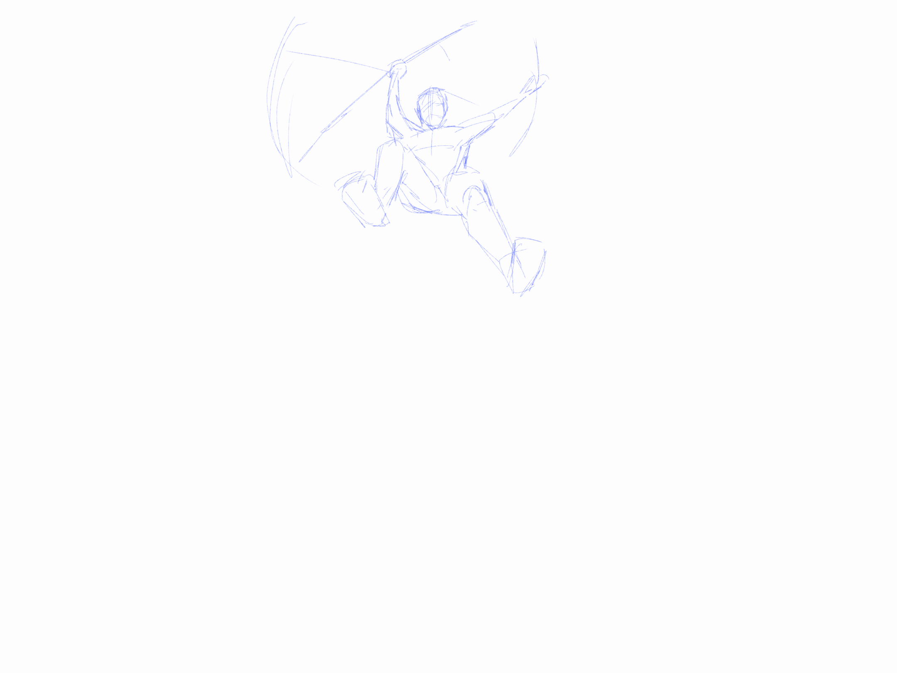

# EVS 2

## Cowboy

Animation d'un cowboy qui utilise une carabine comme un baton pour se battre. J'ai utilisé procreate pour dessiner chaque frame, et j'ai ensuite assemblé l'animation sur Krita. Poour le storyboard, je me suis basé sur des animations pré existantes sur Youtube que j'ai recréé avec mon propre personnage.
Je l'ai gardé relativement courte pour prioriser le mouvement dynamique et les poses complexes
## Animation

## Storyboard

