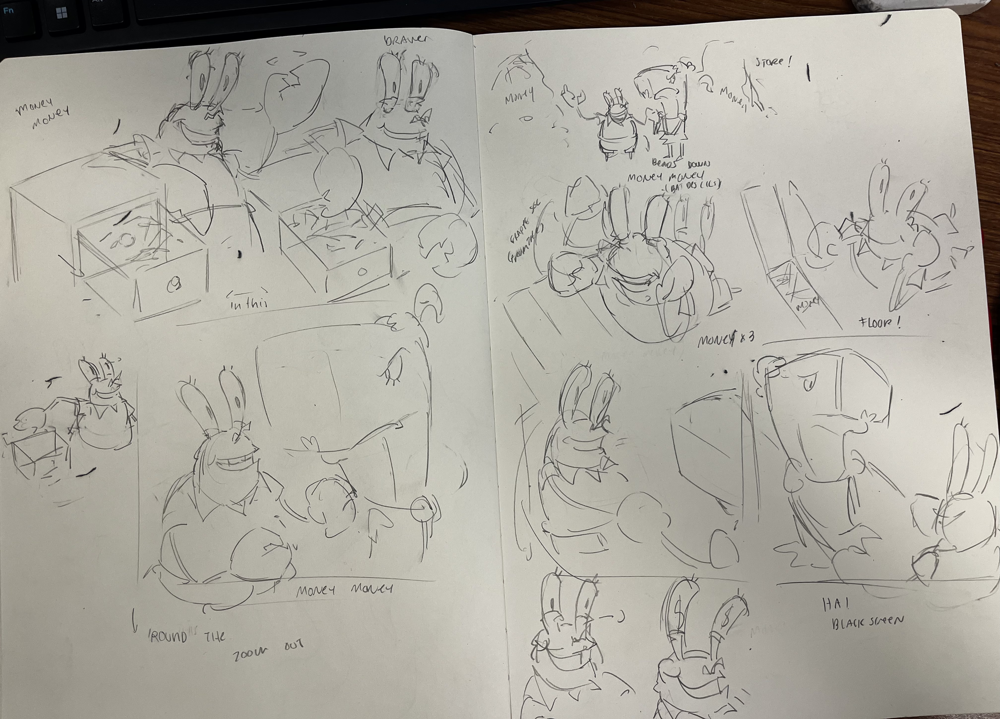

# Journal

## Cours 5-8

## Cours 5
Test d'animation simple pour me familiariser avec Krita

## Cours 6
Pratique de long storyboard traditionelle (faite pour accompagner une chanson de la comédie musicale de Bob l'éponge)

## Cours 7
Pratique d'animation lip sync avec audio + pratique d'animation du personnage utilisé pour EVS-2. Cette animation a été faite en entier sur procreate, et l'audio a été rajouté sur Capcut.  
Elle est plus fluide car les mouvements sont moins dynamique et complexe que dans l'animation finale. je me suis concentré sur les mouvements de bouches pour les faire refléter ce que le personnage doit dire. 
[Source de l'audio (L4D2)](<https://www.youtube.com/watch?v=BXdO01f-luM>) 

https://github.com/user-attachments/assets/a3afad7d-3298-47aa-9523-c7b6a9560c23

## Cours 8
Préparation de l'animation évaluée (Voir EVS 2) + finalisation de la référence pour le personnage a animer

